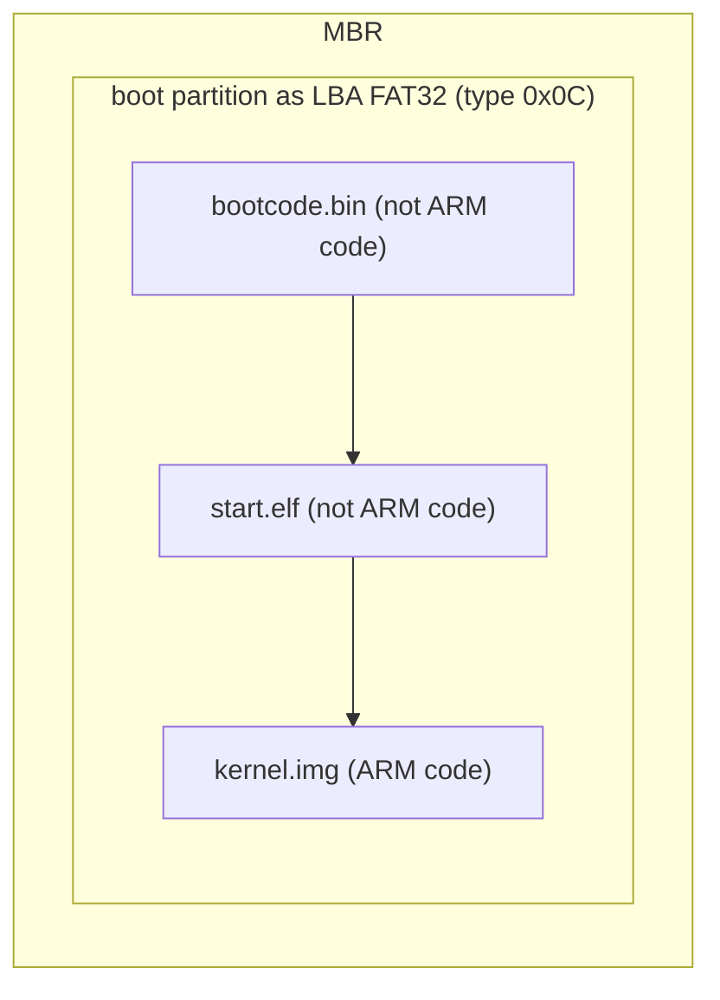

# ARM compiling

The official ARM/GNU Embedded Toolchain, gcc-arm-none-eabi, is **NOT** the same
as Linux's Embedded Toolchain, aarch64-elf. Specifically regarding the assembler 
definitions, syntax flavors, and built-in preprocessor macros. ARM originally
hosted their official, maintained bare-metal toolchain project on Launchpad.
Now it is on github. It contains `newlib-nano` or `picolibc` \(not sure on this is,
some sources say or others don't say\). `newlib-nano`, which is a mature,
standardized, and includes stable specs integrations along with newer embedded
libraries like `picolibc`.

## Boot Process

This is what the boot process looks like for the Raspberry Pi 3 \(from what I gathered\).



The partition seems to called *boot*, not sure if this is required. For newer version, I think they can use `gpt`
volumes with `kernel8.img`

## GCC-ARM-NONE-EABI

Used here and for [bare_metal](https://github.com/adamransom/bare_metal/tree/master)

```bash
sudo apt update && sudo apt upgrade -y
sudo apt install gcc-arm-none-eabi gdb-multiarch build-essential -y
arm-none-eabi-gcc --version
```

This could be an old version, check with:

```bash
apt policy gcc-arm-none-eabi
```

## GCC-aarch64-elf

Do **NOT** use this for this project! It is used by [raspi3-tutorial](https://github.com/bztsrc/raspi3-tutorial)
and is presented here for furture reference.

### Install Prerequisites

```bash
sudo apt update
sudo apt install build-essential bison flex libgmp3-dev libmpc-dev libmpfr-dev texinfo
```

### Set Up Env

```bash
export PREFIX="/usr/local/cross-compiler"
export TARGET="aarch64-elf"
export PATH="$PREFIX/bin:$PATH"
```

### Download and Extract Source Code

```bash
sudo mkdir -p $PREFIX/src
sudo chown -R $USER $PREFIX
cd $PREFIX/src
```

#### Download Binutils and GCC

Check [ftpmirror](https://ftpmirror.gnu.org) for newer versions
and adjust version numbers as needed.

```
wget https://ftpmirror.gnu.org/binutils/binutils-2.47.tar.gz
wget https://ftpmirror.gnu.org/binutils/binutils-2.47.tar.gz.sig

wget https://ftpmirror.gnu.org/gcc/gcc-16.2.0/gcc-16.2.0.tar.gz
wget https://ftpmirror.gnu.org/gcc/gcc-16.2.0/gcc-16.2.0.tar.gz.sig
```

Once the downloads are finished, verify the downloads by running

```bash
sha512sum *.tar.gz > sha512.sum
sha512sum -c sha512.sum --ignore-missing
```

The it should say **OK** for the files.

```bash
for i in *.tar.gz; do tar -xzf $i; done
```

### Building

```bash
mkdir build-binutils
cd build-binutils

# Adjust version number if using another version
../binutils-2.47/configure --target=$TARGET --prefix="$PREFIX/" \
--with-sysroot --disable-nls --disable-werror
make -j$(nproc)
make install
cd ..
```

- `--with-sysroot` enables target library/header lookup in a simulated root directory 
- `--disable-nls` turns off Native Language Support to enhance build speed and reduce errors.

### Build GCC

```bash
mkdir build-gcc
cd build-gcc

../gcc-16.2.0/configure \
    --target=$TARGET \
    --prefix=$PREFIX \
    --disable-nls \
    --enable-languages=c \
    --without-headers

make -j$(nproc) all-gcc
#make -j$(nproc) all-target-libgcc

# Install them into your PREFIX directory
make install-gcc
#make install-target-libgcc
cd ..
```

### Verify the Installation

```bash
$TARGET-gcc --version
```
